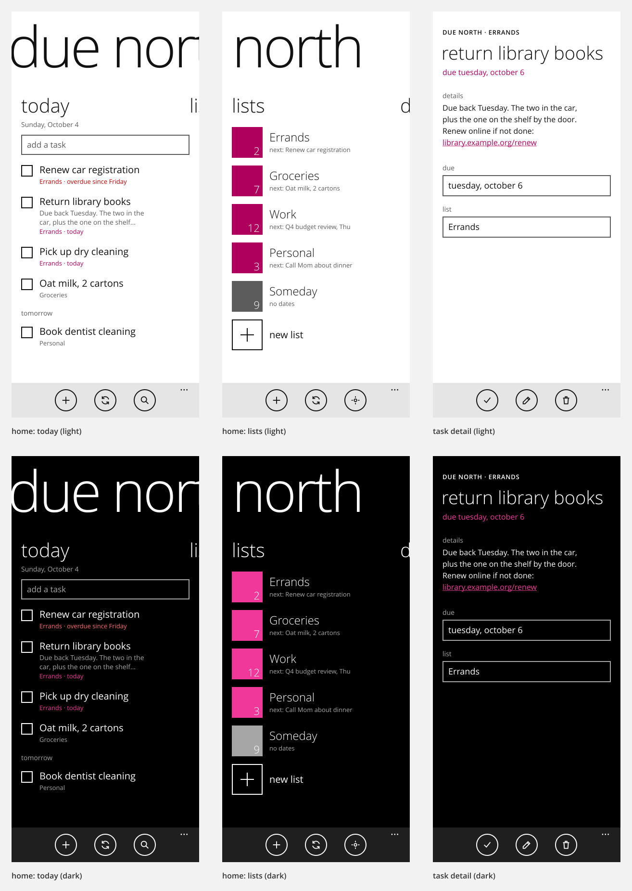
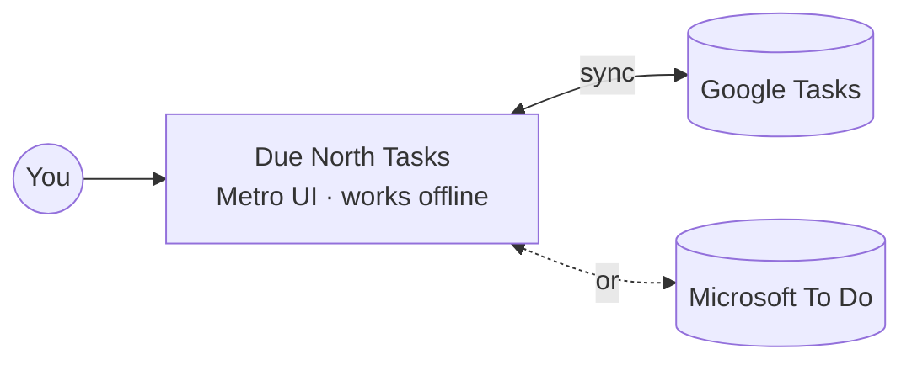

# Due North Tasks

A Windows Phone 8.1 **Metro**-style todo app for Android that syncs with **Google Tasks or
Microsoft To Do**, one at a time.

The chosen look is **Light Panorama**: a white home screen with a huge "tasks" title (with "due north" under it) you
swipe across (today, any pinned lists, lists, stats), one magenta accent, and light and dark modes that follow your phone. The full set of design
options is on the [design canvas](https://claude.ai/artifact/UchFxrZaZuaB9Aq82iuQDE).

## Status

Built, at version 0.1.2: Google Tasks and Microsoft To Do sync, shared
lists, reordering, templates, stats, pinned lists and the about page. Each feature was specified
with [GitHub Spec Kit](https://github.com/github/spec-kit) before it was built:

| Read this | For |
|---|---|
| [constitution](.specify/memory/constitution.md) | The non-negotiables: Metro design rules, fast and fluid UX, one provider at a time, offline first |
| [spec 001](specs/001-metro-todo-app/) | The app itself: spec, plan, research, data model, contracts and the original 69 build tasks |
| [screen map](specs/001-metro-todo-app/contracts/ui-screens.md) | Every screen, its app bar and menus |
| [spec 002](specs/002-shared-lists/) | Shared lists (To Do) and assigned tasks (Google) |
| [spec 003](specs/003-reordering/) | Reordering tasks, steps and lists |
| [spec 004](specs/004-templates/) | Task and list templates |
| [spec 005](specs/005-stats/) | The stats section |
| [release notes](docs/release/README.md) | Signing, Play Console and the Google verification steps |

## Building it

Open the project in Android Studio, or run `./gradlew assembleDebug`. Client IDs go in
`local.properties` (see [docs/release/README.md](docs/release/README.md)); never commit them.
New features start with `/speckit-specify` (the Spec Kit skills are in `.claude/skills/`).
