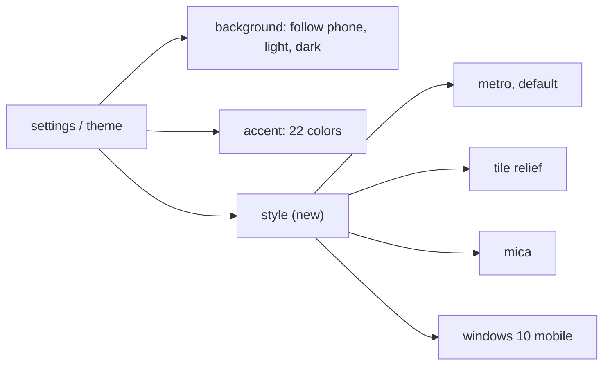
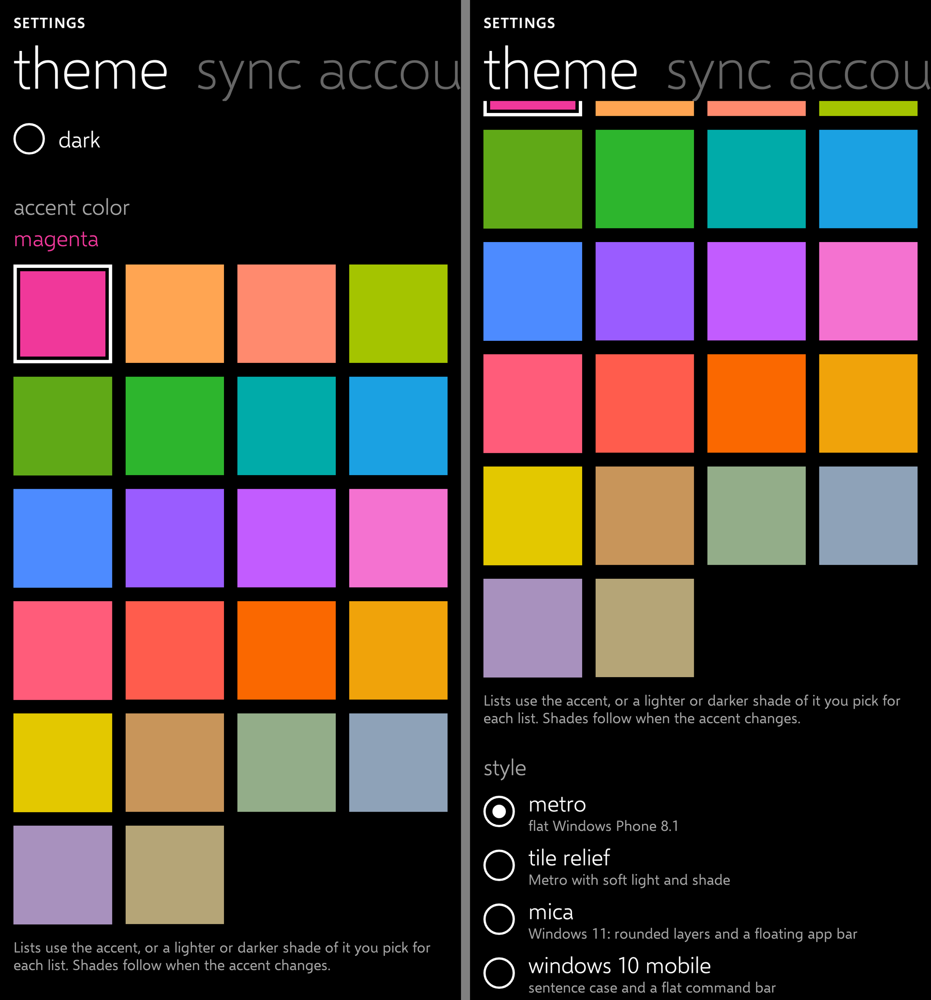
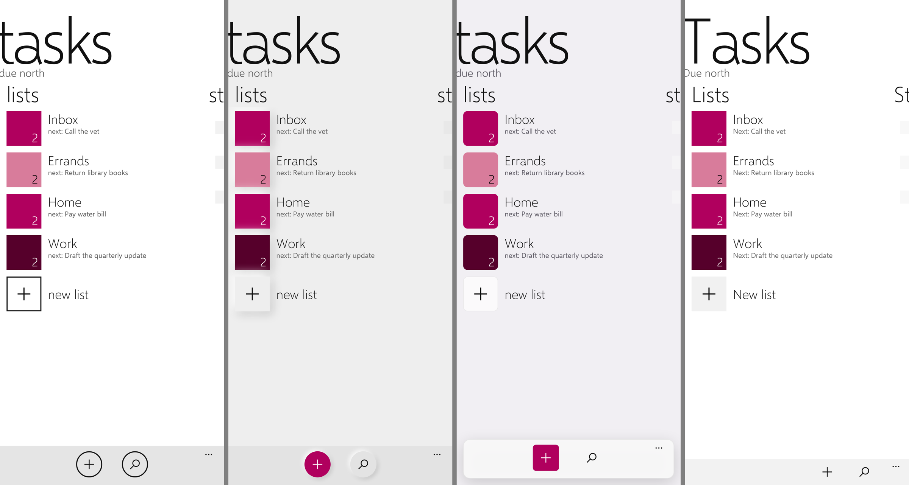
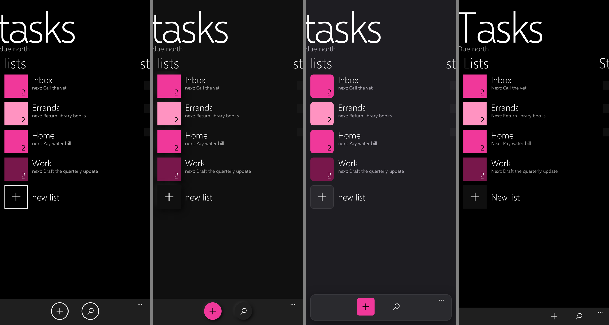

# Feature Specification: Styles

**Feature Branch**: `006-styles`

**Created**: 2026-10-30

**Status**: Implemented

**Input**: User description: "Add theming and all the themes that are in Due North Budget app"

## At a glance

Due North Budget's settings offer four styles beside light/dark and the accent. Due North Tasks
already shares Budget's 22 accents and its light/dark choice, so what it lacked is the style. This
feature adds Budget's four styles under settings, theme, "style", in light and dark, with every
accent.

| Style | Page | Tiles, buttons, boxes | App bar | Text |
|---|---|---|---|---|
| metro | white / black | flat, 2dp outlines | grey band, round outlined buttons | lowercase |
| tile relief | light / dark grey | raised by soft light and shade; text boxes pressed in | raised round buttons, add filled with the accent | lowercase |
| mica | tinted grey | rounded layer cards with a hairline edge; Windows 11 check box | floating acrylic sheet of bare glyphs, add filled | lowercase, smaller pivot headers with an accent selector line |
| windows 10 mobile | white / black | grey filled buttons, grey outlined boxes | flat 48dp command bar, glyphs right-aligned | sentence case, smaller pivot headers |

## Requirements

- **FR-001**: Settings, theme lists the four styles as radio buttons under "style"; a pick applies
  to every screen at once, with no restart.
- **FR-002**: Metro is the default; a stored style that no longer exists falls back to it.
- **FR-003**: Every style works in light and dark and with every accent; accent text and secondary
  text keep 4.5:1 on each style's page.
- **FR-004**: The style is a display preference kept on the phone (theme settings DataStore) and is
  never sent to Google Tasks or Microsoft To Do (constitution Principle VI).
- **FR-005**: The styles are drawn by the design system's components (app bar, button, check box,
  text box, list tile, pivot, context menu, dialogs, accent grid), so screens need no changes.
- **FR-006**: Colors, light and shade and corner sizes match Due North Budget's
  `MetroStyle`/`MetroSurface`, so the two apps look alike when set alike.

## Constitution

Tile relief and mica use shadows and rounded corners, which Principle I's "content over chrome"
rule forbids. Constitution 2.0.0 allows them as opt-in styles, with Metro the default.

## Screenshots

Theme picker before and after (dark):

The lists section in metro, tile relief, mica and windows 10 mobile:

