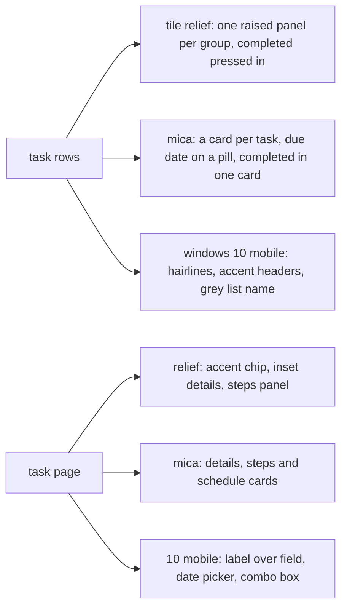
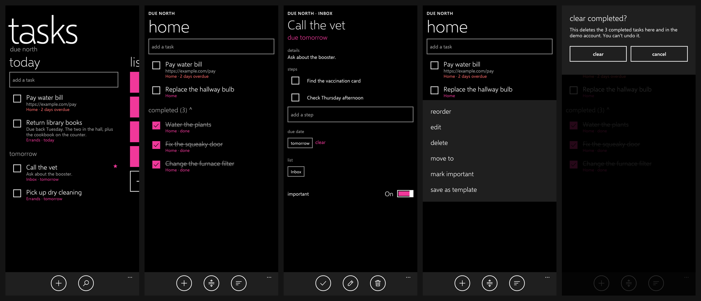
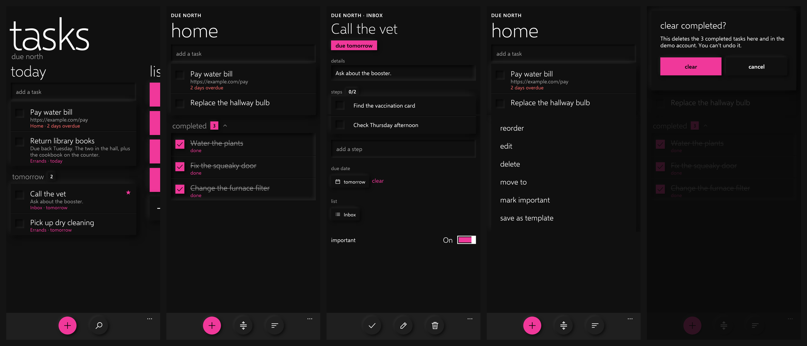
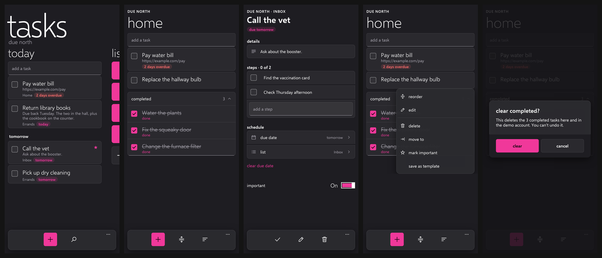
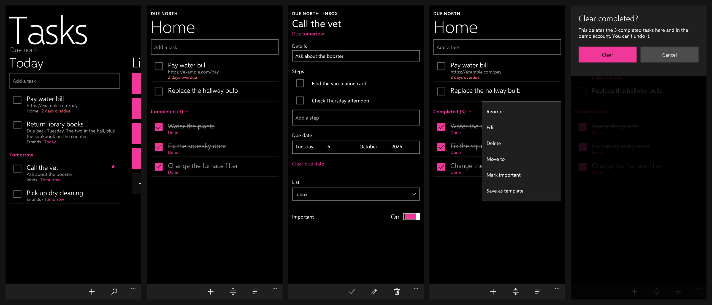
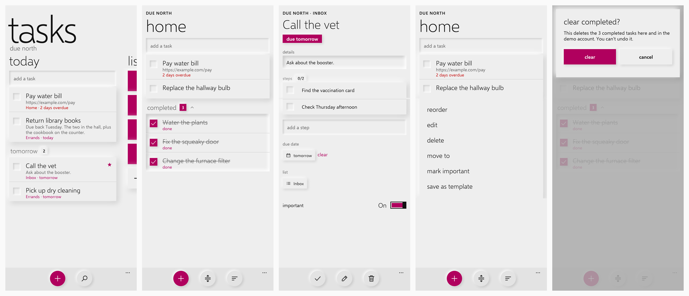
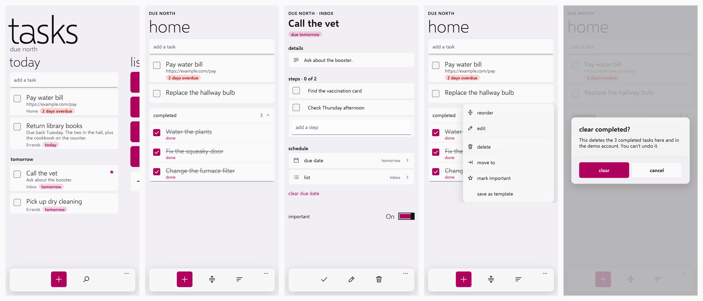
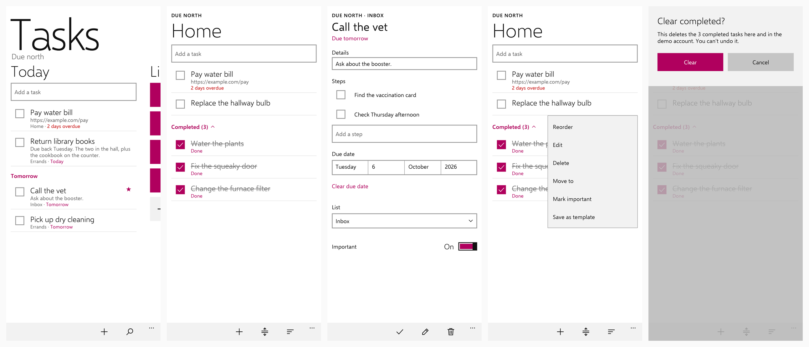

# Feature Specification: Style the Content

**Feature Branch**: `007-style-content`

**Created**: 2026-10-30

**Status**: Implemented

**Input**: User description: "Style more of the content of the app for each theme in mockups. Don't implement
until I okay the mockup." The owner approved every mockup ("keep them all").

## At a glance

Spec 006 gave each style its components (app bar, buttons, boxes, tiles, pivot). This feature styles the screens'
own content: task rows and their group headers, the task page, row menus and dialogs. Metro is unchanged.

| | tile relief | mica | windows 10 mobile |
|---|---|---|---|
| Task rows | one raised panel per group, rows split by a groove; clear boxes pressed in | each task its own card; due date on a tinted pill, red when overdue | a hairline under each row; list name grey, due date in the accent |
| Group headers | raised count badge (accent for completed) | small semibold; completed is the top of one card with its rows | accent semibold, "Completed (3)" with a chevron |
| Completed tasks | an inset (pressed) panel | one expander card | as rows |
| List page | the list's own name left out of captions | same | same |
| Task page | due date as a raised accent chip; details in a well; steps on a panel with a done/total badge; date and list buttons with glyphs | semibold title, due pill; details, steps (ending in add a step) and schedule cards | sentence-case labels over each field; details in a box; date picker (day, date, month, year); list combo box |
| Row menu | raised panel | narrower acrylic flyout at the right, glyph per item, a line before delete | menu flyout edged in grey |
| Dialogs | raised panel off the top, confirm in the accent | centered rounded dialog, buttons on a footer band, confirm in the accent | top band, confirm in the accent |

## Requirements

- **FR-001**: Under Metro every screen looks as before.
- **FR-002**: The three other styles draw the content above in light and dark with every accent, from the design
  system (`groupSurface`, `MetroPill`, `MetroButton(primary)`, `ContextMenuItem.icon`) so screens only say where a
  row sits in its group.
- **FR-003**: Under Windows 10 Mobile, links keep the case they were typed in.

## Screenshots

`StyleContentScreenshotTest` records today, a list page, the task page, a row menu and the clear-completed dialog
for each style, light and dark.

