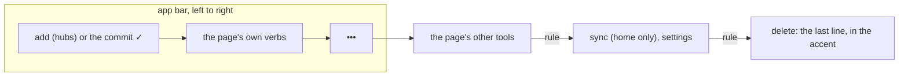

# Feature Specification: Menu cleanup

**Feature Branch**: `008-menu-cleanup`

**Created**: 2026-11-05 · **Revised**: 2026-11-06

**Status**: Implemented

**Input**: User description: "Give me suggestions on how to clean up the menu organization. I want
consistency, predictability, and discoverability. Make sure it is clear between complete, save, add
actions in the UX." Then: "Build suggestions and logs should go into settings." Then: "Use the same
rules Due North Budget uses for its menu system as far as naming and organization go."

## At a glance

The app bar and its menus follow Due North Budget's rules (its `ScreenBar.kt` and spec 008
"streamlined controls"). Where this spec differs from an earlier one (003 FR-203, 004 FR-310/311,
001's home menu), this spec wins.

A form (typing, or a page that only collects input) has save and cancel on the bar, delete alone in
its menu, and no way off to settings. A long-press menu runs edit first, the item's verbs, and delete
last in the accent.

## The glyphs

| Glyph | Means | Label (menu, TalkBack) | Caption under the button |
|---|---|---|---|
| + | make a new thing | add task, add list, add template | the noun alone: task, list, template |
| ✓ | commit the page's main thing | complete / reopen, save, use template, done | the verb when there is no noun: complete, save, use, done |
| ✕ | leave a form without writing | cancel | cancel |
| pencil | open for typing | edit task, edit template | the noun alone: task, template |

The glyph is the verb, so a caption is only the noun when there is one. Complete and save share the
✓ but never share a bar: complete is on the task page while viewing, save replaces it while typing.

## Requirements

- **FR-500**: ✓ commits. It is complete on the task page, save on every form, use on a list
  template, and done in every reorder mode (replaces 003 FR-203's wording, same glyph).
- **FR-501**: Captions under bar buttons MUST be the noun alone when the label has one ("task" under
  + add task); the label stays the screen reader's name.
- **FR-502**: Home (a hub) MUST lead with add (add list on lists, add task elsewhere; on stats it adds
  to today), then search. Its menu: the section's own tools (unpin from home, reorder lists,
  templates), then under a rule sync and settings, settings last. Sync account and sync log are
  reached from settings.
- **FR-503**: Object pages (a list, a task while viewing, a list template, a task template while
  viewing, templates) MUST put their verbs on the bar and the rest in the menu, then settings under a
  rule, then delete as the last line in the accent.
- **FR-504**: Forms (the task and task template pages while typing, new list from template) MUST
  show only save and cancel on the bar. Cancel leaves without writing; back while typing saves. Delete,
  where there is one, is alone in the menu. The new list from template page has no in-page buttons.
- **FR-505**: "save as template" reads "make template" (replaces 004 FR-310/311); list tiles offer it
  too. Creating says "add": add task, add list, add template, "add" on new-thing dialogs.
- **FR-506**: Task long-press menus MUST be the same on home and a list page: edit (opens the task
  ready for typing), reorder (list page, open tasks), move to list, mark important, make template,
  delete. The list tile and list page menus list the same items in the same order. The list page's
  sharing button shows on every list.
- **FR-507**: Delete in a long-press menu, and every destructive overflow line (delete list, delete
  task, delete template, sign out), MUST be drawn in the accent, last, under a rule.
