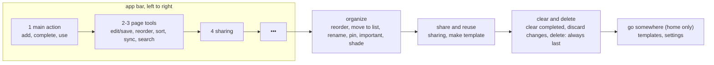

# Feature Specification: Menu cleanup

**Feature Branch**: `008-menu-cleanup`

**Created**: 2026-11-05

**Status**: Implemented

**Input**: User description: "Give me suggestions on how to clean up the menu organization. I want
consistency, predictability, and discoverability. Make sure it is clear between complete, save, add
actions in the UX." Then: "Build suggestions and logs should go into settings."

## At a glance

Every app bar and menu follows one template, and each of the four action verbs has one icon and one
meaning. Where this spec differs from an earlier one (003 FR-203's ✓ "done", 004 FR-310/311's "save
as template", 001's home menu), this spec wins.

A long-press menu uses the same order, with "edit" first and no destinations.

## The four verbs

| Verb | Means | Icon | Where |
|---|---|---|---|
| complete / reopen | The task is finished (same as ticking its box) | Check | Task and step check boxes; first button on the task page |
| save | Write the title and details as typed | Save | Task and task template pages, in edit's slot, only while typing |
| add | Make a new thing | Add | First button on home, a list and templates; the add boxes; every "add ..." dialog |
| done | Leave reorder mode | Reorder | The only button in reorder mode |

Check is only ever complete. "use" on a list template has its own play glyph.

## Requirements

- **FR-500**: Check MUST mean complete only. Reorder modes (tasks, lists, steps, template tasks) show
  a single Reorder "done" button; back also ends them (replaces 003 FR-203's ✓).
- **FR-501**: The task page app bar MUST be: complete / reopen, then edit, which becomes save while
  the title or details are open. Its menu: reorder steps, move to list, discard changes (while
  editing), delete. Back while editing saves and stays on the page, like complete does. A caption
  under the fields says everything else saves as it changes.
- **FR-502**: The task template page MUST use the same edit / save button and the same menu order
  (reorder steps, discard changes, delete), with no complete.
- **FR-503**: "save as template" MUST read "make template" everywhere (replaces 004 FR-310/311). A
  list tile's long-press menu also offers it.
- **FR-504**: Creating MUST use "add": add task, add list, add template, add task (list template),
  "add" on new-thing dialogs, "add list" on the use template page. "+ add details" reads "more
  details" and the add box's list picker is titled "list".
- **FR-505**: Home's first button MUST be add on every section (add list on lists, add task
  elsewhere; on stats it adds to today), so sync and search never move.
- **FR-506**: Home's menu MUST hold only the section's own actions, then templates and settings.
  Sync account and sync log are reached from settings.
- **FR-507**: Task long-press menus MUST be the same on home and a list page: edit (opens the task
  ready for typing), reorder (list page, open tasks), move to list, mark important, make template,
  delete.
- **FR-508**: The list page and the list tile menus MUST list the same items in the same order:
  (reorder,) rename, pin / unpin, list shade, sharing (tile; a button on the page), make template,
  (clear completed, page only,) delete. The list page's sharing button shows on every list, and
  "list info" is gone.
- **FR-509**: Steps say "delete", not "remove". Sync account's sign out moves from a Close button to
  its ••• menu.
