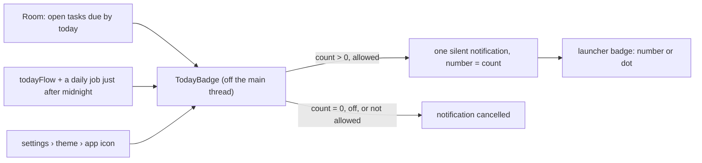

# Feature Specification: Today count on the app icon

**Feature Branch**: `009-today-badge`

**Created**: 2026-11-06

**Status**: Implemented

**Input**: User description: "Add notification badge support to the app and use the today task list
count for the number."

## At a glance

Like a Windows Phone live tile's count, the app icon shows how many tasks the home "today" section
holds: open tasks that are overdue or due today, in every list. Android launchers draw their icon
badge from an app's notifications, so the count rides on one quiet notification.

## Requirements

- **FR-600**: The badge number MUST equal the today section's count: open, not deleted tasks due
  on or before today, in lists that are not deleted. Tomorrow's tasks are not counted.
- **FR-601**: The badge follows ticks, edits, adds, deletes and syncs at once (it reads Room), and
  the date rolling over at midnight, also when the app is not running (a daily WorkManager job).
- **FR-602**: At zero, or with the setting off, the notification is cancelled so no badge shows.
- **FR-603**: The notification is quiet: low importance, no sound, vibration or pop-up, shown only
  on the phone (not bridged to watches), no time stamp. Its title is "N tasks for today" with up to
  five titles; tapping it opens the app. Its channel is "today".
- **FR-604**: Android 13+ needs the notification permission. The app asks once, on the first
  launch after this feature arrives, and never again by itself. Settings › theme › "app icon" has
  a "show today's count" toggle (on by default). Turning it on while notifications are not allowed
  asks again while Android still lets the app ask, and otherwise opens the app's notification
  settings. While notifications are not allowed the toggle reads off and a caption says why.
- **FR-605**: Posting runs off the main thread, waits for a burst of sync writes to settle (half a
  second), and only posts when the count or titles change (constitution Principle II).
- **FR-606**: The setting lives only on the phone and is never sent to either service.

## Notes

Launchers decide how a badge looks: Pixel and most stock launchers show a dot, Samsung, Nova and
others show the number. The notification's number is what number-showing launchers read.
