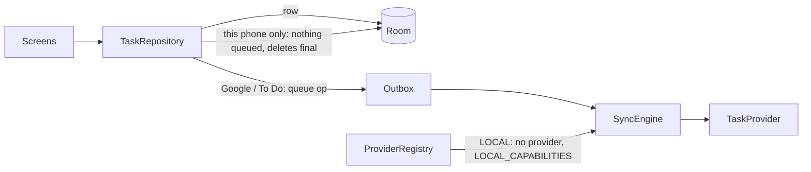

# Feature Specification: This phone only (offline, no account)

**Feature Branch**: `010-offline-provider`

**Created**: 2026-11-22

**Status**: Implemented

**Input**: User description: "I want an offline provider option as well"

## At a glance

Beside Google Tasks and Microsoft To Do, the sync account picker offers **this phone only**: no
account, no sign-in, and tasks that live only in the phone's database and never sync. It counts as
the one "service" (constitution Principle III). Switching from it to a real service copies the
phone's lists and tasks up to that service if the user leaves "copy" ticked in the confirmation.

## Requirements

- **FR-700**: The account picker and the sync account page offer "this phone only" for every
  build, needing no client ID. Picking it writes the account row (`ProviderKind.LOCAL`) and a
  default "Tasks" list, with no sign-in.
- **FR-701**: With "this phone only", no change is queued for sync, and deletes (task, step, list,
  clear completed) remove the rows at once.
- **FR-702**: No `TaskProvider` is bound for it: the registry returns none, so the sync engine does
  nothing and shows no progress dots. Its capabilities are `LOCAL_CAPABILITIES`: the importance
  star, and order kept in the phone's own keys (as for To Do).
- **FR-703**: The sync account page hides "sync every", "sync on Wi-Fi only", the sync status and
  the sync button; the hub menu has no "sync" item. Notes that name a service ("details sync as
  notes in...", the order note, "here and in ...") say "here" or are left out.
- **FR-704**: "Delete all tasks" in the menu asks first and says plainly that every list, task and
  template on the phone is deleted and kept nowhere else. Switching from a service to it signs out
  of that service as any switch does, and starts the phone empty.
- **FR-705**: Switching from it to a service asks first, with a "copy my lists and tasks to
  <service>" check box, ticked to start with; the message says what happens either way. Unticked,
  the switch works like any other: the phone is cleared and the service starts as it is. Ticked,
  sign-in comes first, so a failed or cancelled sign-in changes nothing. Then, in one
  write, the account row names the service and every list, task and step is queued as a create
  (lists first; each list's tasks bottom first, since Google adds new tasks at the top), and a
  sync runs. The phone's default list becomes an ordinary list beside the service's own default.
  Templates stay. Nothing on the service is changed or deleted; the copied lists are added beside
  what is already there.

## Out of scope

- Backup or export of the phone's tasks.

## Tests

- `core/data` `LocalOnlyTest`: nothing queued, deletes final, registry has no provider but local
  capabilities.
- `app` `LocalOnlySessionTest`: connecting needs no sign-in and makes a list, sync does nothing;
  switching to a service asks, then copies every list, task and step up to it with nothing lost,
  or with the box unticked clears the phone and sends nothing;
  a failed sign-in leaves the phone as it was.
- `ScreenScreenshotTest`: account picker (light, dark) and sync account page for this phone only.
