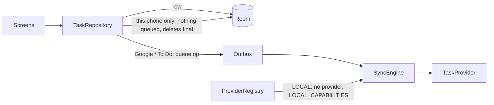

# Feature Specification: This phone only (offline, no account)

**Feature Branch**: `010-offline-provider`

**Created**: 2026-11-22

**Status**: Implemented

**Input**: User description: "I want an offline provider option as well"

## At a glance

Beside Google Tasks and Microsoft To Do, the sync account picker offers **this phone only**: no
account, no sign-in, and tasks that live only in the phone's database and never sync. It counts as
the one "service" (constitution Principle III), so picking a real service later leaves it, and
leaving it deletes its tasks, since there is no other copy.

## Requirements

- **FR-700**: The account picker and the sync account page offer "this phone only" for every
  build, needing no client ID. Picking it writes the account row (`ProviderKind.LOCAL`) and a
  default "Tasks" list, with no sign-in.
- **FR-701**: With "this phone only", no change is queued for sync, and deletes (task, step, list,
  clear completed) remove the rows at once.
- **FR-702**: No `TaskProvider` is bound for it: the registry returns none, so the sync engine does
  nothing and shows no progress dots. Its capabilities are `LOCAL_CAPABILITIES`: the importance
  star, and order kept in the phone's own keys (as for To Do).
- **FR-703**: The sync account page hides "sync every", "sync on Wi-Fi only", the sync status and
  the sync button; the hub menu has no "sync" item. Notes that name a service ("details sync as
  notes in...", the order note, "here and in ...") say "here" or are left out.
- **FR-704**: Leaving it (switching to a service, or "delete all tasks" in the menu) asks first
  and says plainly that every list, task and template on the phone is deleted and not copied
  across. Switching from a service to it signs out of that service as any switch does.

## Out of scope

- Copying the phone's tasks up to Google Tasks or To Do when switching (a later feature; it would
  need its own confirmation under Principle III).
- Backup or export of the phone's tasks.

## Tests

- `core/data` `LocalOnlyTest`: nothing queued, deletes final, registry has no provider but local
  capabilities.
- `app` `LocalOnlySessionTest`: connecting needs no sign-in and makes a list, sync does nothing,
  leaving warns and clears the phone without touching the new service.
- `ScreenScreenshotTest`: account picker (light, dark) and sync account page for this phone only.
