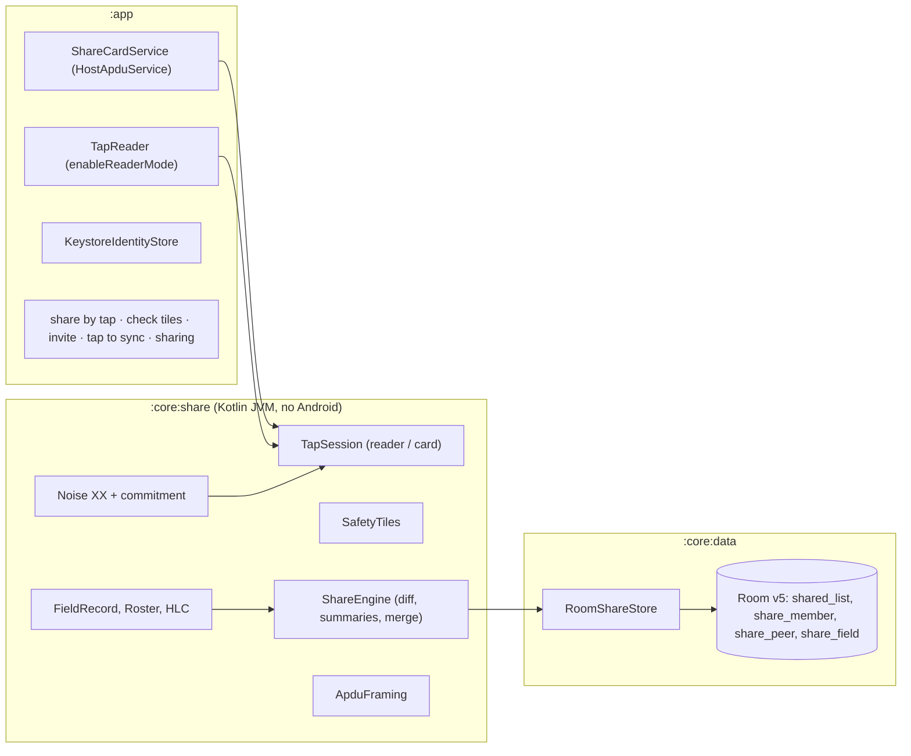

# Implementation Plan: Share by tap

**Spec**: [spec.md](spec.md) · **Plan for Dustin**: `plan/tap-to-share/plan.md` in the project files.

## Shape

## Decisions

- **Crypto library: BouncyCastle (bcprov, lightweight API)** instead of Tink, which the first plan
  named. Noise needs ChaCha20-Poly1305 with an explicit counter nonce; Tink only exposes that in
  internal classes and leans on JCE ChaCha (API 28+). BouncyCastle has X25519, Ed25519, ChaCha20-
  Poly1305 and SHA-256 in pure Java on API 26, and runs in plain JVM tests.
- **No list key.** Records only ever travel inside a tap's Noise session between two current
  members, so a group key would add nothing; removal is a roster entry instead of a key change.
  Signatures still prove who wrote each change.
- **Change capture by diff.** Instead of hooking every repository write, the engine compares each
  shared list's rows with the last field records it holds and turns differences into new records
  (clock from the row's `localUpdatedAt`). Deleted rows become tombstones.
- **Shared ids are local ids.** Lists, tasks and steps keep the same `localId` on every phone, so
  no mapping table is needed.
- **Wire format:** kotlinx-serialization JSON, deflated, framed into APDUs with chaining.

## Risks

- NFC throughput between phones varies; measured on real phones before release (task S020).
- Android may route our AID to the card service only while the screen is on and unlocked; that is
  the intended behaviour.
