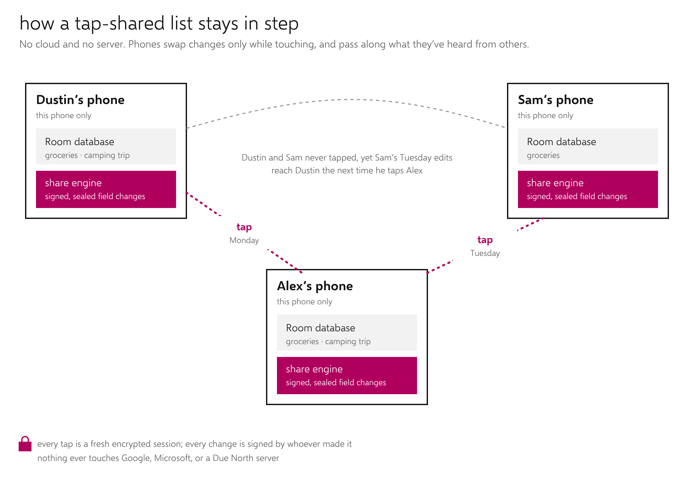
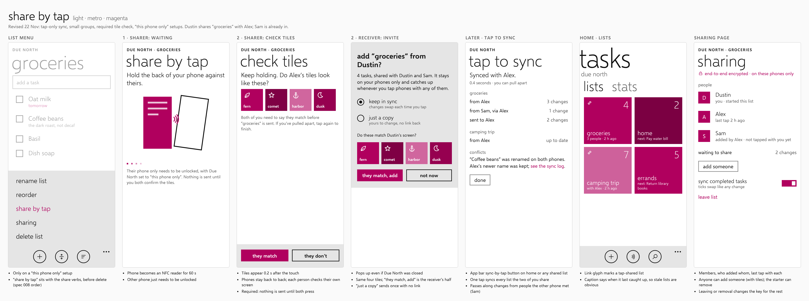
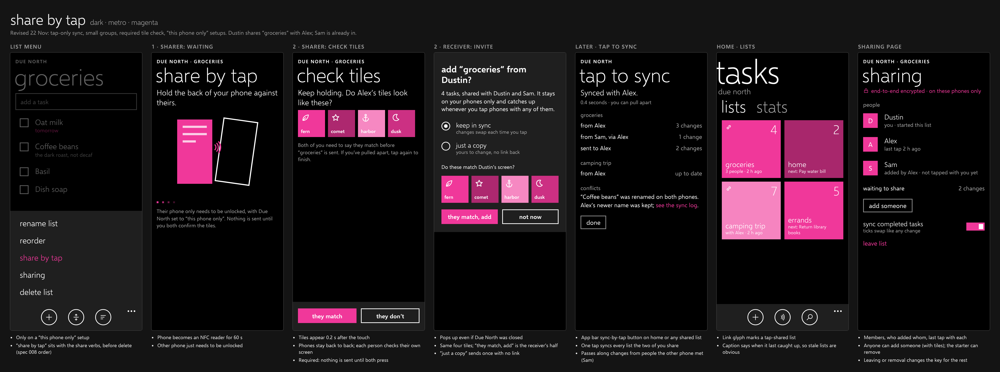

# Feature Specification: Share by tap

**Feature Branch**: `011-share-by-tap`

**Created**: 2026-11-23

**Status**: Approved (Dustin, 2026-11-22: "Go")

**Input**: User description: "I want a new feature where two users can use a tap of their phones
together to send and sync lists to each other. The system needs to be as secure as possible
without compromising usability. If it can be e2e encrypted, do it."

Decisions (Dustin, 2026-11-22): no server, lists sync only when phones tap; small groups; the
safety-tile check is required; a tap finishes the sync near instantly; keep "just a copy"; completed
tasks sync; **only on "this phone only" setups** (spec 010).

## At a glance

On a "this phone only" setup, a list can be shared by holding two phones back to back. The tap
swaps keys over NFC, both people confirm four matching **safety tiles**, and the list crosses over.
From then on, whenever any two members tap, every list they share catches up in about a second,
including changes from members the other phone has met. Nothing leaves the phones: no Google, no
Microsoft, no Due North server.

## User Scenarios

### US1 - Share a list with someone (P1)

Dustin is on "this phone only". On "groceries" he opens the menu and picks **share by tap**. The
page says "hold the back of your phone against theirs" with running progress dots. Alex's phone is
unlocked; Due North isn't open. When they touch, Alex's phone opens Due North on an invite: "add
'groceries' from Dustin?", the members, a choice of **keep in sync** (default) or **just a copy**,
and four safety tiles. Dustin's page shows the same four tiles. Each presses "they match" while the
phones still touch, and the list appears on Alex's phone.

**Acceptance**:
1. Nothing about the list (name, tasks, members) is sent before both people confirm.
2. If either presses "they don't" (or "not now"), the session ends and neither phone keeps the
   other's keys.
3. If the phones part before both confirm, nothing is sent and the sharer's page says "tap again to
   finish"; the next touch starts over at the tiles.
4. "Just a copy" gives Alex an ordinary list with no link back; later taps don't touch it.
5. If Alex's phone is on Google Tasks or To Do, it shows "share by tap needs 'this phone only'" and
   nothing is sent.

### US2 - Tap to catch up (P1)

Later, Dustin presses **tap to sync** (home app bar, or a shared list's app bar) and touches Alex's
phone. In about a second both phones have each other's changes for every list they share, and
Dustin's page lists what moved: "from Alex 3 changes, from Sam via Alex 1 change, sent to Alex 2
changes", plus any conflicts. Alex's phone shows a short notification "synced with Dustin".

**Acceptance**:
1. Phones that have verified each other before skip the tiles.
2. Only lists both phones are current members of are exchanged.
3. Changes by any member travel through any other member (gossip).
4. Two edits to different fields of the same task both survive; two edits to the same field keep
   the later one and log the loser in the sync log.
5. A broken-off tap changes nothing on either phone (all or nothing).

### US3 - Groups (P2)

The sharing page lists everyone, who added them, and when you last tapped them. **Add someone**
starts share by tap. The person who started the list can **remove** a member; anyone can **leave**.

**Acceptance**:
1. A removed or departed member gets no further changes from anyone who knows about the removal.
2. They keep their copy as an ordinary list.
3. A group holds at most 8 people.

## Requirements

- **FR-800**: "share by tap", "tap to sync" and the tap-sync section of the sharing page appear only
  while the account is "this phone only".
- **FR-801**: Each install has one identity: an Ed25519 signing key and an X25519 key, kept
  encrypted under an Android Keystore key that never leaves the phone.
- **FR-802**: Pairing and every sync tap run the Noise `XX_25519_ChaChaPoly_SHA256` handshake over
  NFC (sharer = reader, other phone = Host Card Emulation, which works with Due North closed). The
  initiator commits to its identity key and a nonce in message 1 so a man in the middle can't grind
  for matching tiles.
- **FR-803**: Safety tiles are four of 16 glyph-and-word pairs taken from the final handshake hash.
  Both people MUST confirm them the first time two phones meet.
- **FR-804**: A phone remembers a verified peer (identity key, name, when verified). Later taps
  with it skip the tiles; its identity key is checked by the handshake.
- **FR-805**: Shared data is field records: list title; task title, details, due date, done,
  star, order, steps, deleted. Each record carries a hybrid logical clock, its author's identity
  and the author's signature. A phone only accepts records signed by a member.
- **FR-806**: A sync tap swaps, per shared list, the newest clock seen from each member, then sends
  only the records the other phone lacks. It is applied in one database transaction.
- **FR-807**: Conflicts: per field, the latest clock wins, ties broken by author key. A delete beats
  older edits; a later edit brings the task back. Losing values go to the sync log.
- **FR-808**: The roster is a set of signed entries: "added by", "removed by the starter", "left".
  Records are sent only to peers in the current roster.
- **FR-809**: "sync completed tasks" (per list, on by default): when off, a done task stays on its
  phone as it is and ticks aren't sent.
- **FR-810**: The tap must not block the screen (constitution II): handshake under 0.3 s on a
  mid-range phone; work runs off the main thread.
- **FR-811**: Only `android.permission.NFC` is added, with NFC marked not required; phones without
  NFC don't show the feature.
- **FR-812**: Switching away from "this phone only" leaves each tap-shared list (sends nothing,
  the list stays as an ordinary list).

## Out of scope

- Phones without NFC; iPhone.
- Any server, push or remote sync.
- Restoring an identity on a new phone (a new phone taps in again).

## Constitution

- III: tap sharing is a peer link between "this phone only" setups, not a provider. Added as a
  note in the constitution.
- IV: tap-shared lists have no remote; peers merge by FR-807.
