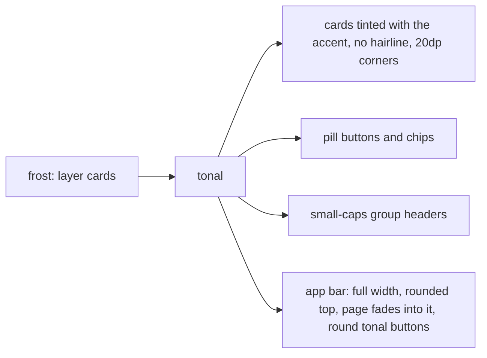

# Feature Specification: Tonal Style

**Feature Branch**: `012-tonal-style`

**Created**: 2026-11-23

**Status**: Implemented

**Input**: User description: "Add the Tonal theme that the Due North Budget app has"

## At a glance

Due North Budget added a fifth style, tonal, on 2026-11-19: half Metro, half Material 3. This brings it to
Due North Tasks under settings, theme, style, in light and dark, with every accent. Tonal builds on frost's
layers (rounded cards, centred dialogs, compact pivot) and changes their look.

| | frost | tonal |
|---|---|---|
| Page | tinted grey | near white or black moved toward the accent |
| Cards | white layer, hairline edge, 8dp corners | a step deeper into the accent, no edge, 20dp corners |
| Buttons, chips | 6dp rounded | pills |
| App bar | acrylic sheet floating a gutter in; add filled with the accent | full-width sheet with 24dp top corners, page fades into it; every glyph on a round tonal container |
| Group headers | small semibold | small caps, letter-spaced, in the variant ink |

## Requirements

- **FR-001**: Settings, theme lists "tonal" as a fifth style; it applies at once, with no restart.
- **FR-002**: Page, card and bar tones follow Budget's `TonalTones` (each a neutral lerped toward the accent's
  swatch) and corners follow Budget's `TonalCorner` (card 20dp, control 14dp, floating 24dp).
- **FR-003**: Secondary and overdue text keep 4.5:1 on the tonal card with every accent.
- **FR-004**: The style is stored on the phone as "Tonal" and never synced (Principle VI).

## Constitution

Constitution 2.3.0 adds tonal to Principle I's opt-in styles. Accent fills stay flat; the one gradient is the
page fading into the app bar, as in Budget.
